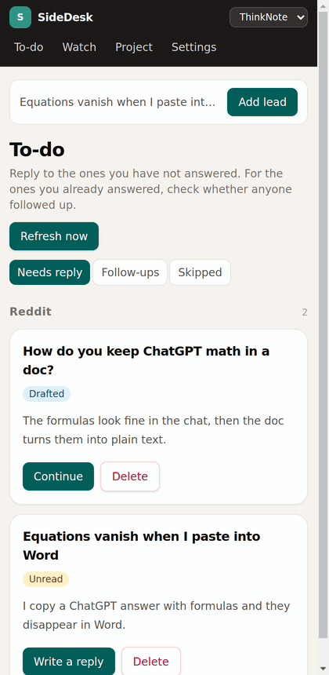

# SideDesk

English · [中文](README.zh.md)



SideDesk is a local follow-up desk for people who answer questions in public communities. It runs on your own computer: a small API, a SQLite database, and a Chrome side panel on the right side of the window you are already browsing.

Use it when you reply on sites such as Reddit, Bilibili, YouTube, V2EX, and Zhihu, and you need one place that remembers two jobs:

1. **New posts worth a reply.** A keyword watch, a link you paste, or the page already open on the left becomes a lead. The to-do list keeps the ones you have not answered.
2. **What happens after you reply.** You paste the link of the comment you sent. SideDesk records it and later checks whether someone answered under it, whether the score changed, or whether the comment disappeared.

You write the reply and post it yourself on the site. SideDesk keeps the queue, the draft, and the comment link. Copy the draft, paste it on the original page, and send it there.

A **project** is whatever you are talking about. The first launch creates an empty project named 默认. You set the name, the background, and the watches. The background is notes for the drafting model: what this thing is, what it can do, what you will not claim, and the tone. SideDesk was built while promoting ThinkNote. The desk itself does not assume a product.

## A day with it

1. Open **Project** and write the background. You can also store two short follow-up lines, Chinese and English, for the case where someone asks for more. Those lines stay off the first reply. Copy one only when they ask.
2. Open **Watch** and add a keyword or a link. A keyword is sent to Reddit search. A link is recognized by site: a post becomes a lead that needs a reply; your own comment is stored so it can be checked later. You can also add the page already open on the left, with no watch at all.
3. Open the side panel. **To-do** has three filters: needs a reply, follow-ups on replies you already sent, and skipped. Pick one item. The original page opens on the left. The draft for that item stays on the right. Changing browser tabs does not replace the draft you are editing.
4. Write the reply yourself, or revise it in chat with a model you connected under **Settings**. Adopting a chat message copies that text into the reply draft. Copy the draft, paste it on the site, and send it yourself.
5. Paste the link of the comment you just posted. SideDesk records it under that lead. Every day at 08:00 `Asia/Shanghai` (change the hour with `DESK_REFRESH_HOUR`), and whenever you press **Refresh now**, it runs the same check: new leads from watches, plus new activity on recorded replies.

`pnpm dev` opens this same panel in a browser tab so you can preview it. That preview cannot see the current tab. After you load the extension in Chrome, the top of the panel recognizes the page on the left.

## What is connected today

| Platform | Find new posts | Save a link you paste | Check under your comment |
| --- | --- | --- | --- |
| Reddit | Keyword search. Needs a script-app key. | Yes. A post or your comment. | Yes. Same key. A new reply, a score change, or a missing comment. |
| YouTube | Not connected. | A video link can be saved. | Comment fetch is not connected. |
| Bilibili | Not connected. | A video link can be saved. | Comment fetch is not connected. |
| V2EX, Zhihu, other | Not connected. | Record a post or a comment link by hand. | Automatic checks are not connected. |

Leave the Reddit key empty and you can still keep leads and paste comment links. Search and the automatic Reddit check stay off until the key is set. Model API keys stay in the local database on this computer.

## Requirements

- Python 3.12
- pnpm
- Chrome

## Run

Start the API. The script creates `.venv` and installs dependencies when they are missing, copies `.env.example` to `.env` when `.env` is missing, and listens on http://127.0.0.1:8765 :

```bash
cd backend
./start-backend.sh
```

The first start creates the empty 默认 project. Add leads and watches from the panel.

Build the extension once:

```bash
cd extension
pnpm install
pnpm build
```

In Chrome, open `chrome://extensions`, turn on Developer mode, choose **Load unpacked**, and select `extension/dist`. Click the extension icon. The side panel opens on the right, on **To-do**. If the API is down, the panel asks you to run `./start-backend.sh`.

Preview the same panel during development:

```bash
cd extension
pnpm dev
```

Open http://127.0.0.1:5175 .

## Configuration

Copy `.env.example` to `.env` in the repository root. `start-backend.sh` does this when `.env` is missing.

Reddit search and comment checks need a script app from [reddit.com/prefs/apps](https://www.reddit.com/prefs/apps). Set `REDDIT_CLIENT_ID`, `REDDIT_CLIENT_SECRET`, and `REDDIT_USERNAME`.

`SEED_PATH` may point at a Markdown file. If the database has no leads yet, startup imports that file once. Leave it unset to skip the import.

## Tests

```bash
cd backend
../.venv/bin/python -m pytest
```

## Layout

- `backend/`: local API and database
- `extension/`: Chrome side panel
- `data/`: SQLite. Not committed.
- `.env`: secrets. Not committed.
